# 🕶️ Vintage Groove Edition — BFD3 + Cubase

### Звук: Lenny Kravitz · Morcheeba · Jamiroquai

> Та же структура, что в рок-версии (мультивыход → группы → Drum Bus), но **другая философия**:
>
> | | 🤘 Рок | 🕶️ Грув |
> |---|---|---|
> | Бочка | щелчок 4 кГц, панч | круглая, тело 70 Гц, почти без клика |
> | Рабочий | выстрел, крэк 5 кГц | ЖИРНЫЙ, низко настроенный, 180 Гц |
> | Верх | яркий, air 10k+ | **тёмный!** LPF и срезы — главный секрет винтажа |
> | Румы | раздавлены в NUKE | маленькая тёплая комната |
> | Клей | SSL + взрывной NY | **ПЛЁНКА** (Studer/Satin) + LA-2A |
> | Динамика | плотная стена | дышит, грувит, «ленится» |

---

## Этап 0 — BFD3 (отличия от рок-сессии!)

- [ ] **Кит:** винтажный — Ludwig/Gretsch 20"–22", рабочий **глубокий деревянный**, настроенный НИЗКО
- [ ] **Tune рабочего: −1…−2 st** (в роке крутили вверх — тут наоборот! жир = низкая настройка)
- [ ] **Tune бочки: −1 st**, Damping меньше рокового — пусть чуть гудит, это «бум» 70-х
- [ ] **Bleed: НЕ прибирать так сильно!** Бочка/рабочий −3…−5 дБ (в роке −7), томы −8. Протечки = клей и винтажная цельность
- [ ] **Vel Dyn: 100 ВЕЗДЕ** ⚠️ — главное отличие! Грув живёт в динамике: ghost-ноты рабочего у Jamiroquai — половина фанка. Никакого выравнивания
- [ ] Хэт: для фанка (Jamiroquai) — тугой яркий; для трип-хопа (Morcheeba) — тёмный, мягкие палки
- [ ] Роутинг выходов — тот же: In→1, Out→2, Top→3, Btm→4, HH→5, Toms→6–8, OH/Room/Amb→St 2/3/4

## Группы — те же + одна замена

```
KICK, SNARE, TOMS, ROOMS, DRUM BUS  (все стерео)
FX: Verb (короткая тёмная комната вместо plate)
FX: FAT  (тёплая LA-2A-параллель вместо взрывного Smash)
```

---

# 🦵 KICK — круглая, как у Kravitz

## `GRV Kick In` — канал

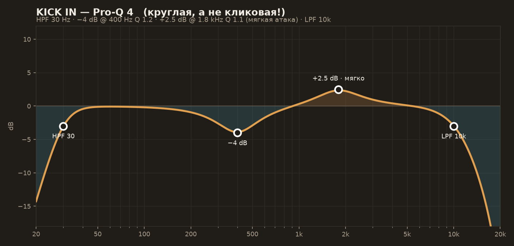

| Band | Тип | Freq | Gain | Q | Зачем |
|---|---|---|---|---|---|
| 1 | Low Cut 24/oct | 30 Hz | — | — | ниже, чем в роке — оставляем больше гула |
| 2 | Bell | 400 Hz | −4 dB | 1.2 | картон |
| 3 | Bell | 1 800 Hz | +2.5 dB | 1.1 | **мягкая атака «тук», а не клик «тык»!** |
| 4 | High Cut | 10 kHz | — | — | винтажный микрофон «не слышал» выше |

Гейт: мягче рока или совсем без него (bleed — наш друг). Если ставите: Range −10 dB максимум.

## `GRV Kick Out` — канал

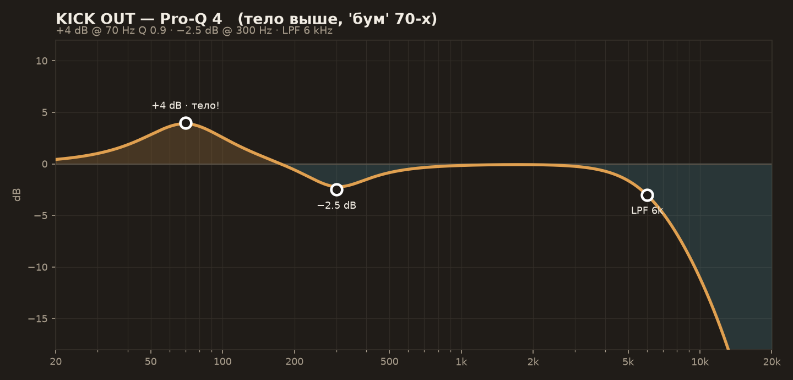

- Bell **+4 dB @ 70 Hz** Q 0.9 — тело выше, чем рок-50: это «бум», который качает
- Bell −2.5 dB @ 300 Hz · High Cut 6 kHz
- ❌ Никакого Submarine/RBass — винтаж живёт на 70–90 Гц, не на сабе

## `GRV Kick GROUP` — группа

**Цепочка:** bx_console (V Gain тот же −90…−85) → **LA-2A** → Decapitator (Style T)

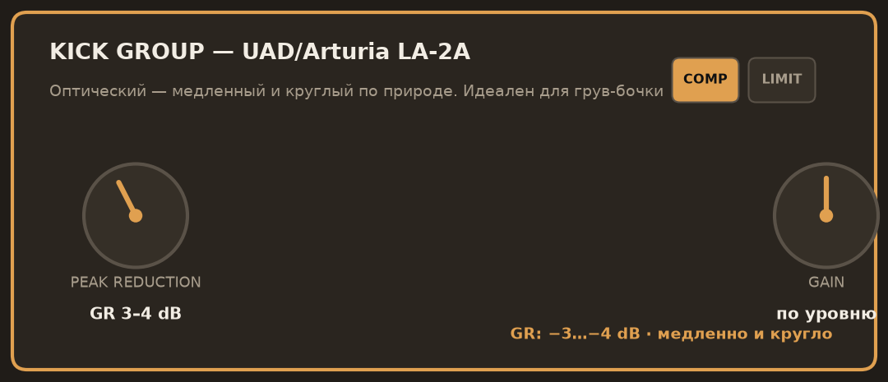

| LA-2A | Значение |
|---|---|
| Режим | **COMP** |
| Peak Reduction | до **GR 3–4 dB** |
| Gain | компенсация |

💡 **Почему LA-2A вместо 1176:** оптический компрессор от природы медленный и «круглый» — он не цепляет атаку и мягко обнимает тело. Это бочка Are You Gonna Go My Way. Нет LA-2A — Cubase Tube Compressor, Ratio 2:1, Attack 30 ms.

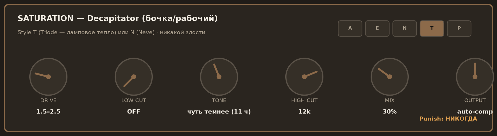

Decapitator: Style **T** (Triode — лампа) · Drive 2 · Tone на 11 часов (темнее) · High Cut 12k · Mix 30%

---

# 🥁 SNARE — жирный и ленивый

## `GRV Snare Top` — канал

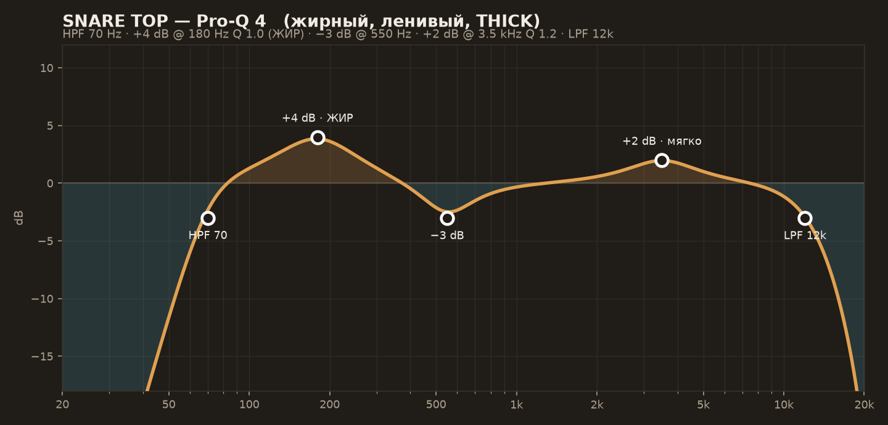

| Band | Тип | Freq | Gain | Q | Зачем |
|---|---|---|---|---|---|
| 1 | Low Cut | 70 Hz | — | — | |
| 2 | Bell | **180 Hz** | **+4 dB** | 1.0 | **ЖИР — главная ручка жанра!** |
| 3 | Bell | 550 Hz | −3 dB | 1.6 | коробка |
| 4 | Bell | 3 500 Hz | +2 dB | 1.2 | присутствие — мягко, не 5k-крэк |
| 5 | High Cut | 12 kHz | — | — | винтажная темнота |

soothe2 тут обычно не нужен — верха и так мало. ⚠️ Ghost-ноты должны остаться слышными!

## `GRV Snare Bottom` — канал

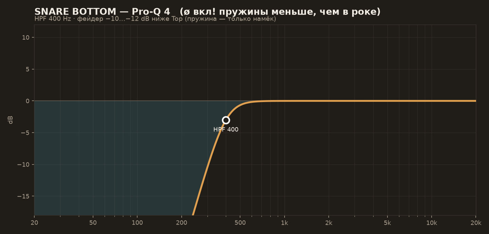

- **ø полярность — как всегда!** · HPF 400 Hz
- Фейдер **−10…−12 dB ниже Top** (тише, чем в роке — пружина лишь намёк, жир важнее стрекота)

## `GRV Snare GROUP` — группа

**Цепочка:** bx_console → CLA-76 (ленивый) → Decapitator N (Mix 15–20%)

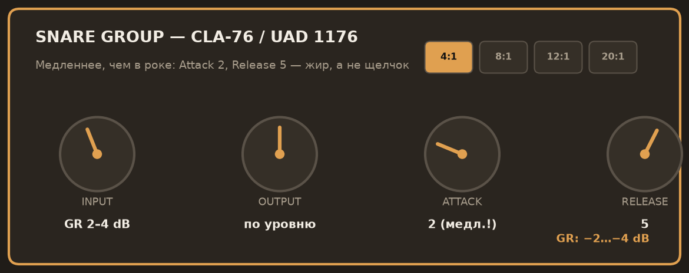

| CLA-76 | Рок было | Грув стало |
|---|---|---|
| Attack | 4 | **2** — ещё медленнее, вся атака пролетает |
| Release | 7 | **5** — хвост «отпускает» лениво |
| GR | 3–5 dB | **2–4 dB** — легче! ghost-ноты не душим |

EnvelopeShaper/Smack Attack — ❌ не нужны: мы не ищем щелчок.

---

# 🛢️ TOMS — тёплые бумы

## `GRV Toms` — каналы

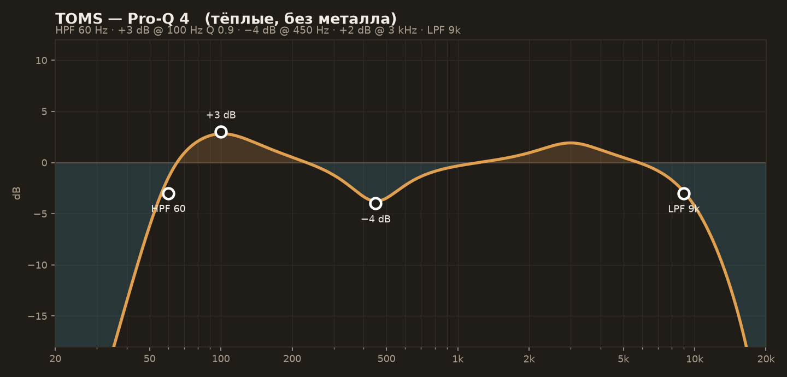

- Гейт **мягкий**: Range −12 dB (не −25, как в роке!) или вовсе без гейта — у Morcheeba томы гудят, и это красиво
- EQ: HPF 60 · **+3 dB @ 100 Hz** (бум!) · −4 dB @ 450 Hz · +2 dB @ 3 kHz · **LPF 9 kHz**
- Transient Designer: ❌ или наоборот **Sustain +2** — длиннее, кинематографичнее (трип-хоп!)

`GRV Toms GROUP`: комп 2:1, Attack 30 ms, GR 2–3 dB — едва касаемся.

---

# 🎩 HI-HAT

- HPF 250 Hz · и — внимание — **shelf −2 dB @ 8 kHz** для Morcheeba-вайба (тёмный хэт!)
- Для Jamiroquai-фанка хэт оставить ярче: без шелфа, только HPF
- Компрессии НЕТ — динамика шестнадцатых это и есть грув

---

# ☁️ OVERHEADS — тьма решает

## `GRV OH` — канал

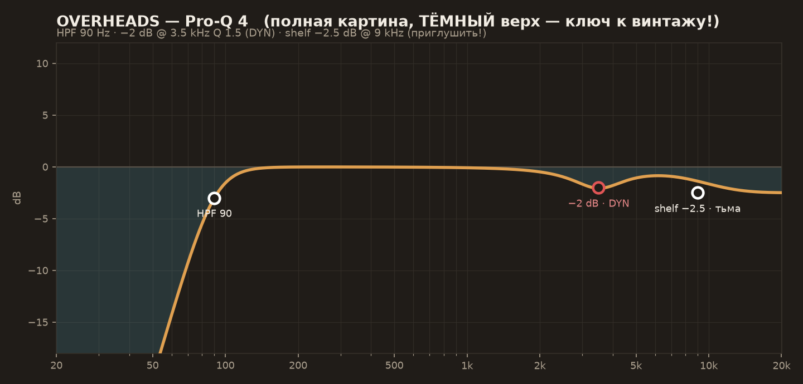

- **HPF 90 Hz — «полная картина»!** В этом жанре OH несут весь кит, не только тарелки
- Bell Dynamic −2 dB @ 3.5 kHz · **High Shelf −2.5 dB @ 9 kHz** — да, РЕЖЕМ верх! Тёмные тарелки = мгновенный винтаж
- Компрессия: LA-2A GR 1–2 dB (вместо «или ничего» — тут лучше с ней: склеивает кит)
- ❌ Никакого Maag Air Band — он враг этого жанра 😄

---

# 🏠 ROOMS — комната, не стадион

## `GRV Rooms` — группа

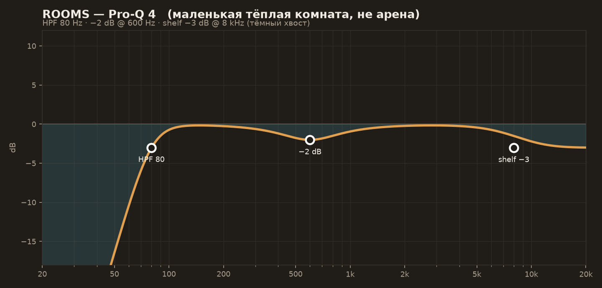
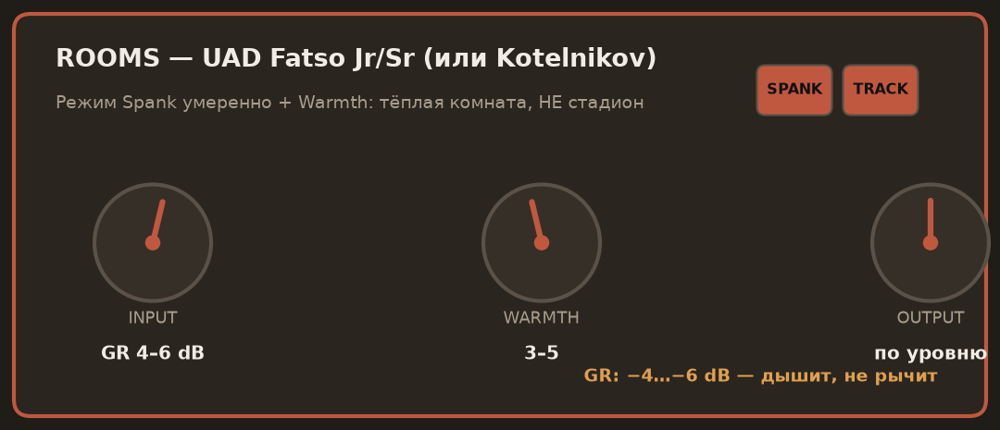

- EQ до компрессии: HPF 80 · −2 dB @ 600 · **shelf −3 dB @ 8k** (тёмный хвост)
- **UAD Fatso (Spank умеренно + Warmth 3–5), GR 4–6 dB** — дышит, не рычит. Или Kotelnikov/The Glue 4:1
- ❌ Distressor NUKE и Devil-Loc оставьте в рок-сессии!
- Фейдер ниже, чем в роке: комната «ощущается», не «гремит»

---

# 🧈 FX: FAT — тёплая параллель (вместо Smash)

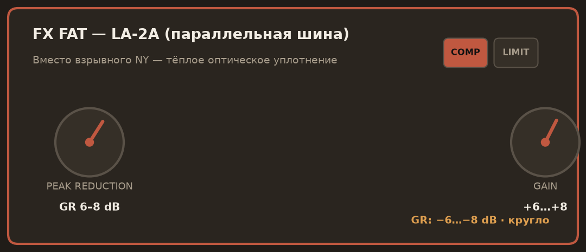
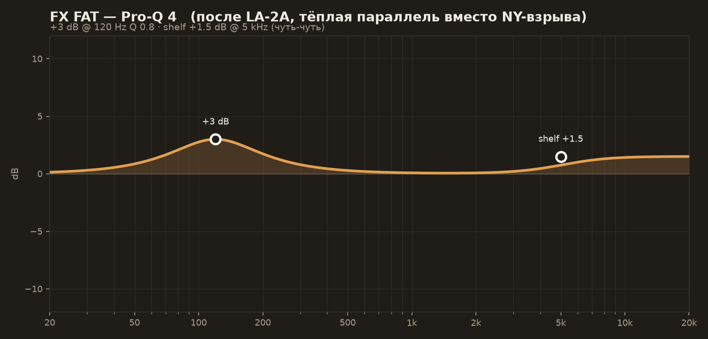

**Цепочка:** LA-2A (GR 6–8 dB) → Pro-Q (+3 dB @ 120 Hz · shelf +1.5 dB @ 5k)

- Send'ы: KICK, SNARE, TOMS (post, 0 dB) — как раньше
- Фейдер: −12…−8 dB под миксом — плотность без «взрыва»
- Это и есть «толстый» звук Jamiroquai: не слышно компрессии, слышно ЖИРНО

---

# 🌊 FX: VERB — маленькая тёмная

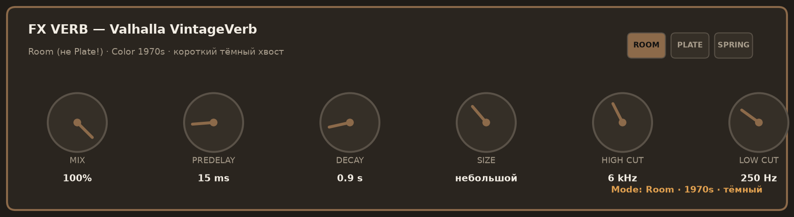

| VintageVerb | Рок было | Грув стало |
|---|---|---|
| Mode | Plate | **Room** |
| Decay | 1.5 s | **0.8–1.0 s** |
| Predelay | 30 ms | **15 ms** |
| High Cut | 8 kHz | **6 kHz** — тёмный хвост |

После верба: Pro-Q HPF 250 / LPF 6k. Send: только Snare (−14 dB) и чуть томы.
💡 Для Morcheeba-трипа попробуйте **Spring**-режим на рабочем — грязноватая пружина = моментальный даб-вайб.

---

# 🚌 DRUM BUS — плёнка правит

**Цепочка:** ПЛЁНКА → Glue (мягко) → Pro-Q → (лимитер по необходимости)

### 1. Плёнка — ГЛАВНЫЙ плагин жанра

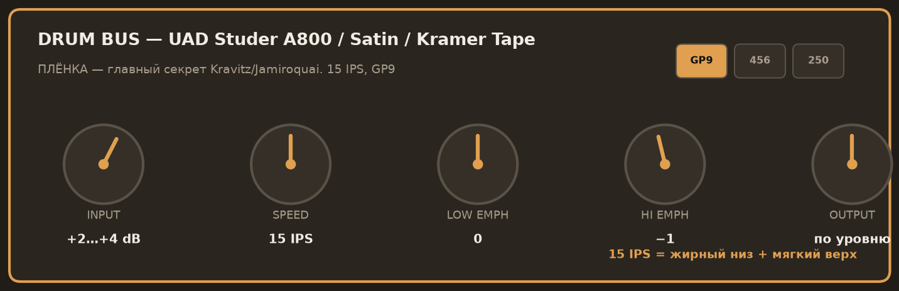

| Studer A800 / Satin / Kramer Tape | Значение |
|---|---|
| Tape Speed | **15 IPS** (не 30! 15 = жирный низ, мягкий верх) |
| Formula | GP9 (или 456 — грязнее) |
| Input | **+2…+4 dB** — пусть плёнка «ест» пики |
| Выравнивание | Output вниз на столько же |

Нет UAD/Satin → **Cubase Magneto III, Saturation 35–45%, HF-Adjust слегка вниз**.

### 2. The Glue — мягче рока

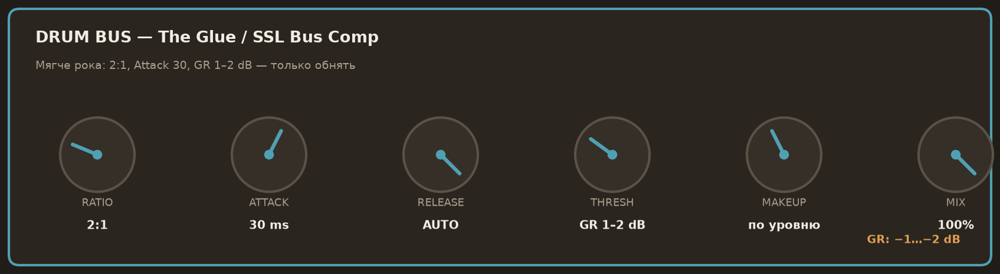

Ratio **2:1** · Attack **30 ms** · Release Auto · **GR 1–2 dB** — только «обнять».

### 3. Pro-Q — винтажный тон

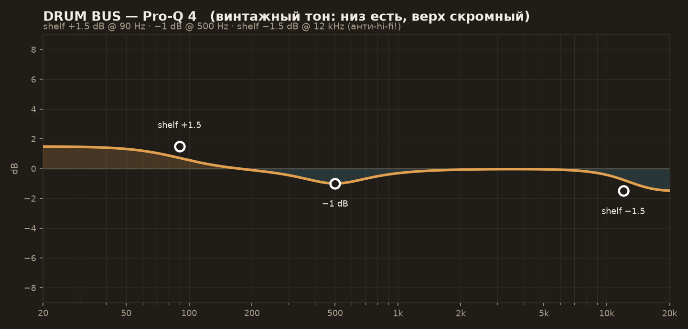

Low Shelf +1.5 dB @ 90 Hz · −1 dB @ 500 Hz · **High Shelf −1.5 dB @ 12 kHz** — финальный «анти-hi-fi» штрих.

---

## 🎚️ Баланс и грув — отличия от рока

1. **Рабочий громче бочки!** В фанке/грувe рабочий — король (в роке были поровну)
2. **OH выше в миксе** — они несут кит целиком
3. **Хэт заметнее** — грув-жанры живут хэтом (Jamiroquai: хэт почти как рабочий!)
4. Swing/shuffle в Groove-редакторе BFD3: 54–58% — «ленивая» сетка Morcheeba
5. Ghost-ноты рабочего: если их не слышно — компрессор душит, ослабьте GR
6. Референсы: Kravitz — Always on the Run · Jamiroquai — Virtual Insanity, Canned Heat · Morcheeba — The Sea

## ❌ Ошибки жанра

1. Яркий верх «как обычно» — винтаж умирает первым делом от 10 кГц
2. Пересушенный bleed/гейты — грув теряет «воздух между нотами»
3. Выровненная velocity — фанк без ghost-нот это марш
4. Слишком много комнаты — Kravitz сухой! (сравните с Nirvana)
5. Клик бочки 4 кГц — сразу выдаёт «современный сэмпл»
