# 🏆 Карточки пресетов PRO — топовые плагины, точные настройки

> Версия на топовых плагинах: FabFilter · UAD/Waves/Arturia · Soundtoys · Empirical Labs ·
> Cytomic · Valhalla · oeksound. Картинки = целевые кривые и положения ручек.
>
> **Как пользоваться:** набираете цепочку → правый клик по инсертам →
> **Save FX Chain Preset** → имя из карточки. Значения — стартовые точки: threshold
> всегда подгоняйте по указанному GR (gain reduction), а не по цифре.

---

# 🦵 KICK

## `PRO Kick In` — канал Kick In

**Цепочка:** Pro-Q 4 → Pro-G

### 1. FabFilter Pro-Q 4

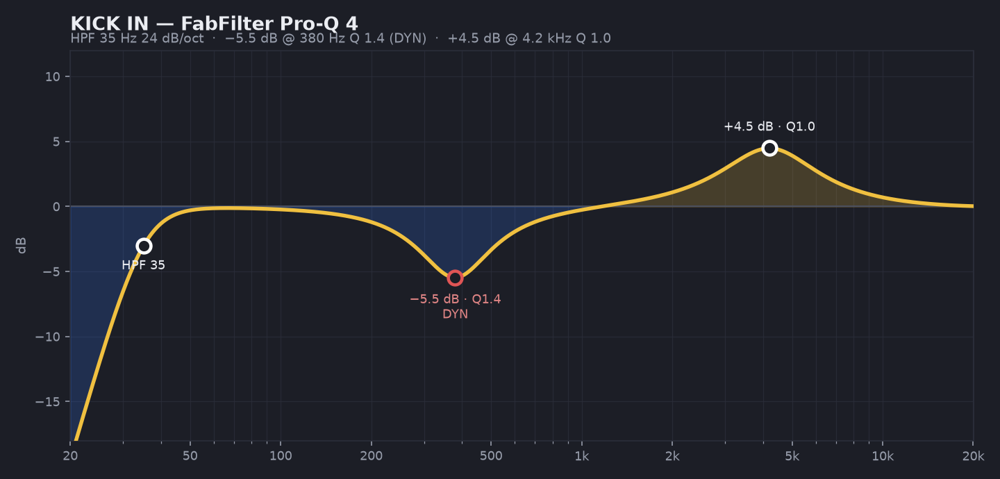

| Band | Тип | Freq | Gain | Q | Примечание |
|---|---|---|---|---|---|
| 1 | Low Cut 24 dB/oct | 35 Hz | — | — | суб-мусор долой |
| 2 | Bell **Dynamic** | 380 Hz | −5.5 dB | 1.4 | «картон»; dyn range −6 dB — давит только гул |
| 3 | Bell | 4 200 Hz | +4.5 dB | 1.0 | щелчок колотушки |

### 2. FabFilter Pro-G
- Style: **Punch** · Threshold: открывается только на удар (~−35 dB)
- Ratio 4:1 · Attack 0.02 ms · Hold 50 ms · Release 100 ms · Range −20 dB (не полный мьют!)

---

## `PRO Kick Out` — канал Kick Out

**Цепочка:** Pro-Q 4 (+ опц. Waves Submarine)

### 1. FabFilter Pro-Q 4

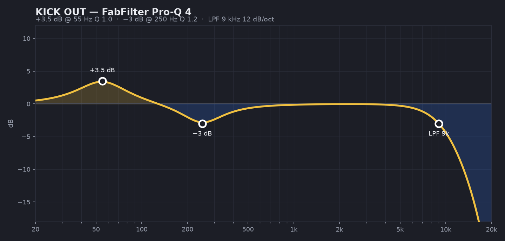

| Band | Тип | Freq | Gain | Q |
|---|---|---|---|---|
| 1 | Bell | 55 Hz | +3.5 dB | 1.0 |
| 2 | Bell | 250 Hz | −3 dB | 1.2 |
| 3 | High Cut 12 dB/oct | 9 kHz | — | — |

### 2. Waves Submarine *(опционально, если бочке нужен суб)*
- Freq: 40–50 Hz · Sensitivity: до жёлтых срабатываний · Wet: −12…−9 dB — тонко!

---

## `PRO Kick GROUP` — группа KICK

**Цепочка:** bx_console SSL 4000 E → CLA-76 → Decapitator

### 1. bx_console SSL 4000 E (Brainworx)
- V Gain (Virtual Gain): 30–40% — лёгкий консольный драйв
- EQ: выкл (сделали в Pro-Q) · Dyn: выкл · THD: In

### 2. Waves CLA-76 / UAD 1176 / Arturia Comp FET-76

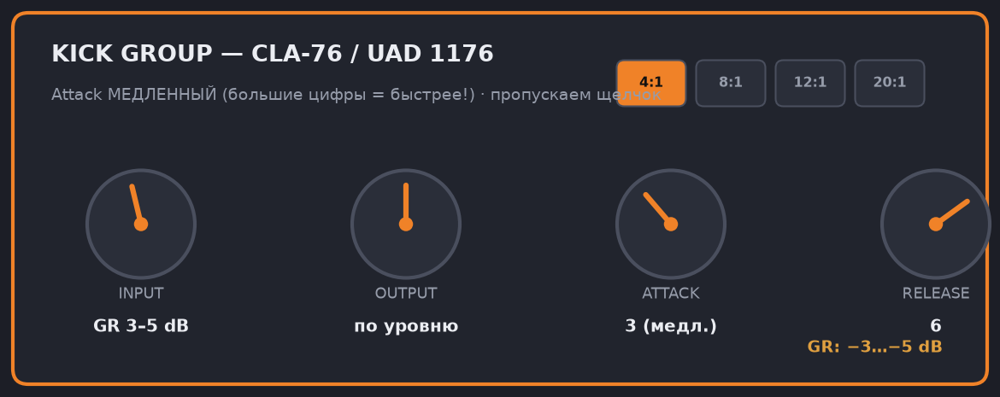

| Ручка | Значение | Важно |
|---|---|---|
| Ratio | **4:1** | |
| Attack | **3** | ⚠️ у 1176 шкала обратная: 3 = МЕДЛЕННО — пропускаем щелчок |
| Release | **6** | средне-быстрый |
| Input | до **GR 3–5 dB** | по стрелке |
| Output | компенсация | A/B по громкости! |

### 3. Soundtoys Decapitator

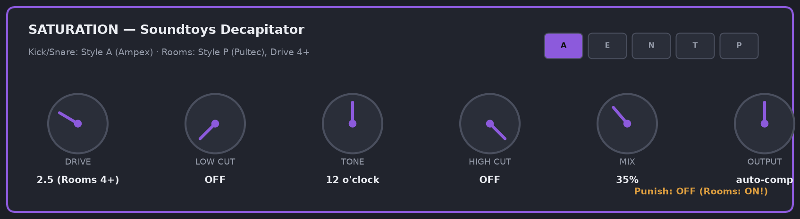

- Style: **A** (Ampex 350) · Drive: **2.5** · Mix: **35%** · Punish: OFF
- Tone: 12 часов · Output: скомпенсировать (−3…−4)

---

# 🥁 SNARE

## `PRO Snare Top` — канал Snare Top

**Цепочка:** Pro-Q 4 (+ soothe2, если звенит)

### 1. FabFilter Pro-Q 4

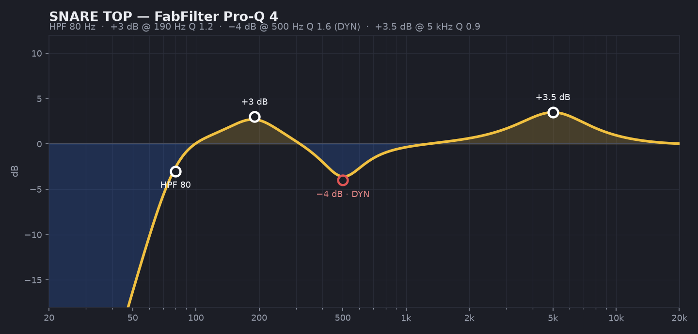

| Band | Тип | Freq | Gain | Q | Примечание |
|---|---|---|---|---|---|
| 1 | Low Cut 24 dB/oct | 80 Hz | — | — | |
| 2 | Bell | 190 Hz | +3 dB | 1.2 | тело |
| 3 | Bell **Dynamic** | 500 Hz | −4 dB | 1.6 | коробка; давит только на ударах |
| 4 | Bell | 5 000 Hz | +3.5 dB | 0.9 | удар/крэк |

### 2. oeksound soothe2 *(если неприятное «кольцо»)*
- Preset-стартер: «Full spectrum tamer» · Depth 4–6 · Sharpness 6 · зона 800 Hz–4 kHz
- Speed: Fast · Delta-кнопкой проверьте, что съедается ТОЛЬКО звон

## `PRO Snare Bottom` — канал Snare Bottom

⚠️ **Сначала: полярность ø ВКЛ** (в MixConsole, секция Pre) · фейдер −8 dB отн. Top

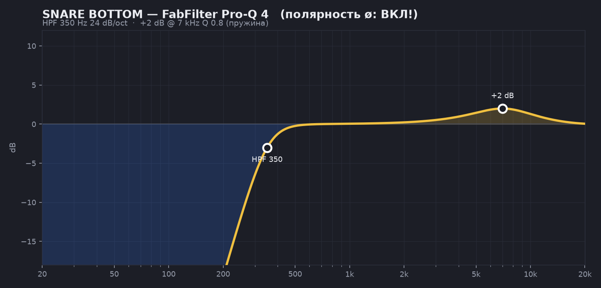

**Pro-Q 4:** Low Cut 24 dB/oct @ 350 Hz · Bell +2 dB @ 7 kHz Q 0.8 (пружина)

## `PRO Snare GROUP` — группа SNARE

**Цепочка:** bx_console SSL E → CLA-76 → Smack Attack → Decapitator (Mix 20%)

### 1. bx_console SSL 4000 E — V Gain 30%, характер

### 2. CLA-76 / UAD 1176

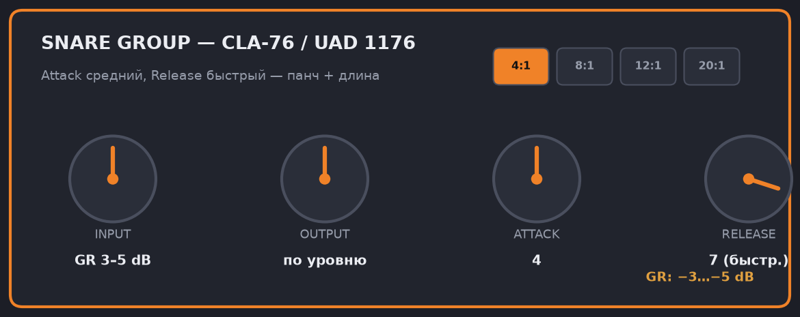

| Ручка | Значение |
|---|---|
| Ratio | **4:1** |
| Attack | **4** (средний) |
| Release | **7** (быстрый — рабочий «дышит») |
| Input | до **GR 3–5 dB** |

### 3. Waves Smack Attack *(если не хватает щелчка)*
- Attack: **+4** · Shape: Needle · Sustain: **−2** · Guard: Clip

### 4. Decapitator: Style **N** (Neve — тепло) или **A** (злость) · Drive 2 · Mix 20%

---

# 🛢️ TOMS

## `PRO Toms` — каналы томов

**Цепочка:** Pro-G → Pro-Q 4 → SPL Transient Designer

### 1. FabFilter Pro-G
- Style: Punch · Attack 0.02 ms · Hold 150 ms (rack) / 180 ms (floor) · Release 300 ms · Range −25 dB

### 2. FabFilter Pro-Q 4

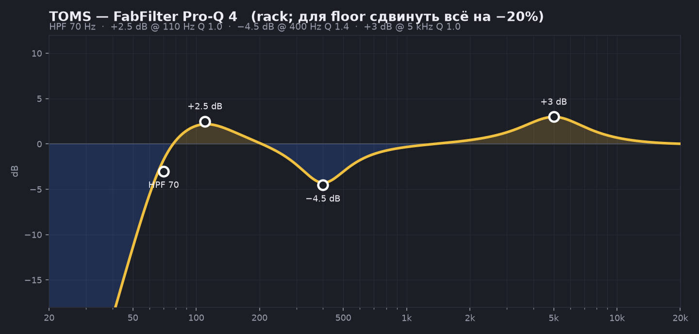

| Band | Тип | Freq (rack) | Freq (floor) | Gain | Q |
|---|---|---|---|---|---|
| 1 | Low Cut | 70 Hz | 55 Hz | — | — |
| 2 | Bell | 110 Hz | 90 Hz | +2.5 dB | 1.0 |
| 3 | Bell | 400 Hz | 350 Hz | −4.5 dB | 1.4 |
| 4 | Bell | 5 kHz | 4.5 kHz | +3 dB | 1.0 |

### 3. SPL Transient Designer: Attack **+4** · Sustain **−2**

## `PRO Toms GROUP`: Pro-C 2 — Style Punch · 4:1 · Attack 20 ms · Release Auto · GR 3–4 dB

---

# ☁️ OVERHEADS

## `PRO OH Modern` — канал OH

**Цепочка:** Pro-Q 4 → soothe2 → UAD LA-2A → Maag EQ4

### 1. FabFilter Pro-Q 4

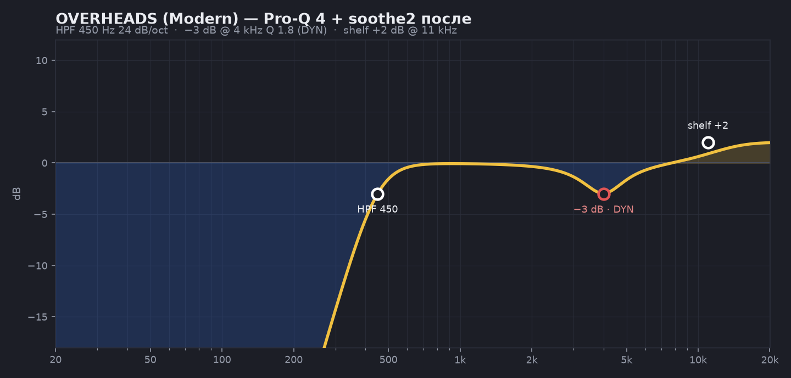

- Low Cut 24 dB/oct @ **450 Hz** (панч дают близкие микрофоны)
- Bell Dynamic −3 dB @ 4 kHz Q 1.8 · High Shelf +2 dB @ 11 kHz
- *(Vintage-вариант: Low Cut 120 Hz вместо 450)*

### 2. soothe2 — ГЛАВНЫЙ плагин для тарелок
- Depth 5 · Sharpness 7 · Selectivity 8 · зона 2–9 kHz · Speed Fast · Stereo Link 80%

### 3. UAD/Arturia LA-2A: режим Compress · Peak Reduction до **GR 1–2 dB** · Gain по уровню

### 4. Maag EQ4: **Air Band 20 kHz +2 dB** — дорогой «воздух»; остальные полосы 0

---

# 🏠 ROOMS

## `PRO Rooms Smash` — группа ROOMS

**Цепочка:** Pro-Q 4 → Distressor → Devil-Loc (или Decapitator)

### 1. Pro-Q 4 (до компрессии!)

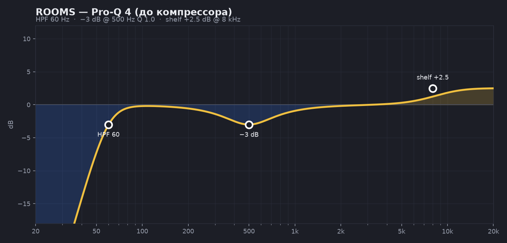

- Low Cut @ 60 Hz · Bell −3 dB @ 500 Hz Q 1.0 · High Shelf +2.5 dB @ 8 kHz

### 2. Empirical Labs Distressor / Arousor

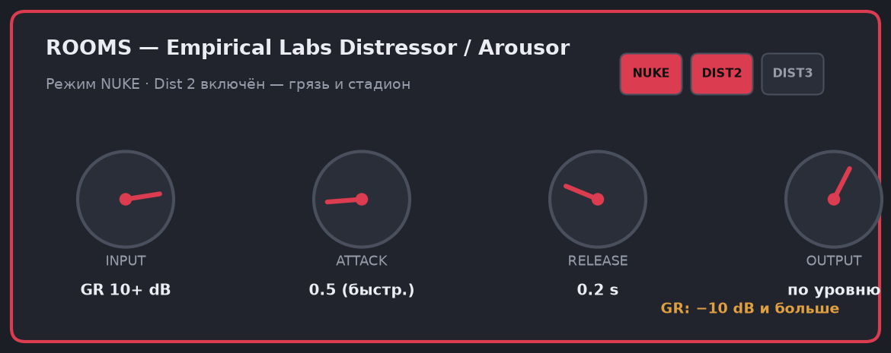

| Ручка | Значение |
|---|---|
| Ratio | **NUKE** (или 10:1) |
| Attack | **0.5** (почти минимум) |
| Release | **0.2 s** |
| Input | до **GR 10+ dB** — пусть качает |
| Detector/Audio | Dist 2 ВКЛ — грязь |

### 3. Soundtoys Devil-Loc Deluxe *(альтернатива/добавка)*
- Crush: **3–5** · Crunch: 2 · Darkness: 2 · Mix: 100% (мы на группе румов — можно всё)

---

# 💥 FX: SMASH (параллельная шина)

## `PRO FX Smash`

**Цепочка:** CLA-76 (All-Buttons-In) → Pro-Q 4

### 1. CLA-76 — режим ALL BUTTONS IN

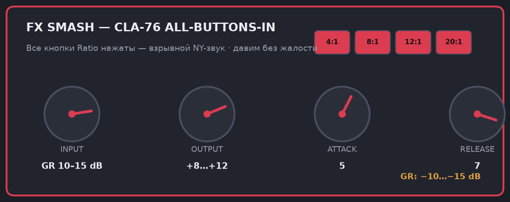

| Ручка | Значение |
|---|---|
| Ratio | **ВСЕ КНОПКИ НАЖАТЫ** (в CLA-76 отдельная позиция «All») |
| Attack | **5** |
| Release | **7** |
| Input | до **GR 10–15 dB** |
| Output | +8…+12 dB |

### 2. Pro-Q 4 после компрессора

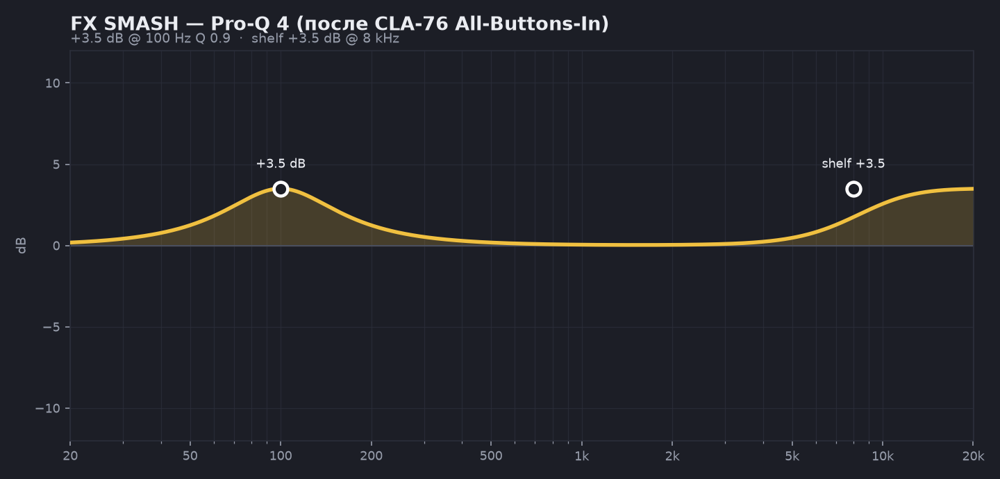

- Bell +3.5 dB @ 100 Hz Q 0.9 · High Shelf +3.5 dB @ 8 kHz

**Send'ы:** с групп KICK, SNARE, TOMS — post-fader, 0 dB. Фейдер шины: с −∞ вверх до плотности (обычно −10…−6 dB).

---

# 🌊 FX: DRUM VERB

## `PRO Drum Verb`

**Цепочка:** Valhalla VintageVerb → Pro-Q 4

### 1. Valhalla VintageVerb

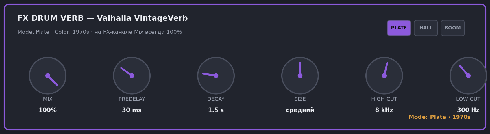

| Параметр | Значение |
|---|---|
| Mode | **Plate** |
| Color | **1970s** |
| Mix | **100%** (FX-канал!) |
| Decay | **1.5 s** (быстрый темп → 1.2 s) |
| Predelay | **30 ms** |
| Size / Mod | по умолчанию |

### 2. Pro-Q 4 после реверба

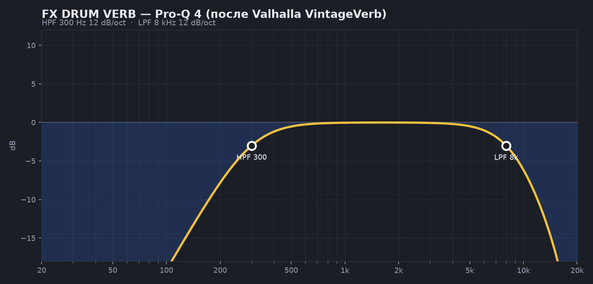

- Low Cut 12 dB/oct @ 300 Hz · High Cut 12 dB/oct @ 8 kHz

**Send'ы:** Snare GROUP (−12…−8 dB), Toms GROUP (−15 dB). Бочка — нет.

---

# 🚌 DRUM BUS

## `PRO Drum Bus`

**Цепочка:** The Glue → Saturn 2 → Pro-Q 4 → Pro-L 2

### 1. Cytomic The Glue / SSL Native Bus Comp 2

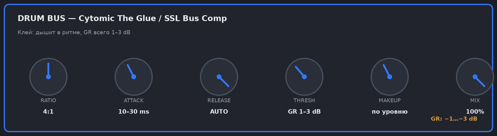

| Ручка | Значение |
|---|---|
| Ratio | **4:1** (мягче — 2:1) |
| Attack | **10–30 ms** |
| Release | **AUTO** |
| Threshold | до **GR 1–3 dB** — стрелка дышит в ритме |
| Mix | 100% (или 70% для мягкости) |

### 2. FabFilter Saturn 2

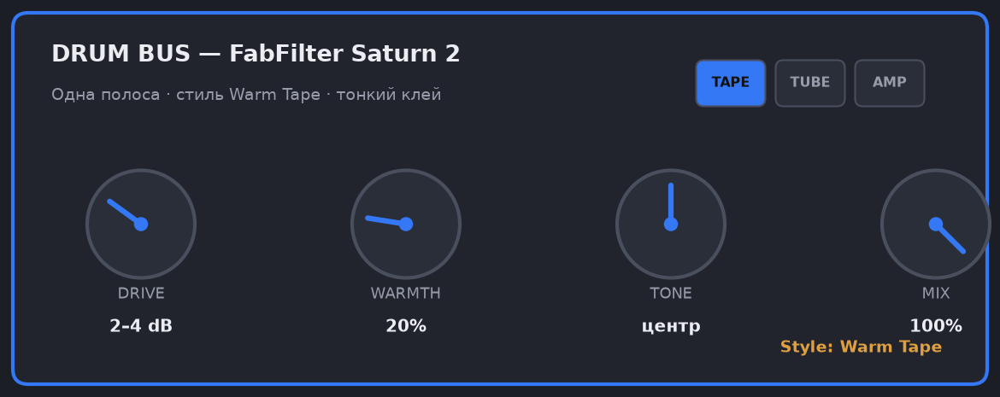

- 1 полоса · Style: **Warm Tape** · Drive: **2–4 dB** · Mix 100%

### 3. Pro-Q 4 — финальный тон

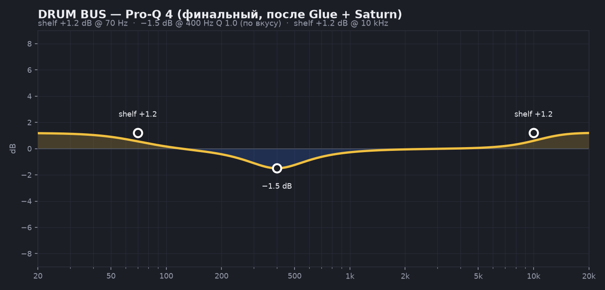

- Low Shelf +1.2 dB @ 70 Hz · Bell −1.5 dB @ 400 Hz (если мутно) · High Shelf +1.2 dB @ 10 kHz

### 4. FabFilter Pro-L 2
- Style: **Transparent** · Lookahead 2 ms · Attack 0.5 ms · Release Auto
- Gain: до срезания пиков **не более 2 dB** · Output −0.3 dB · Oversampling 4x

---

## ✅ Порядок работы

1. Сначала статика: EQ по кривым → гейты → фазы
2. Потом динамика: компрессоры по указанным GR (не по threshold-цифрам!)
3. Потом параллель: Smash и Rooms вкатываются фейдерами под микс
4. В конце Drum Bus: клей слышен как «сжатие кулака» на бэкбите, не как накачка

> 💡 Все картинки в папке `img/` — их можно открыть на втором мониторе при наборе пресетов.
