# 🎛️ Сессия Groove-микса: карта мультитрека + план сведения

> Песня пришла стемами (WAV), не BFD3. Барабаны записаны по микрофонам — значит,
> **все groove-карточки работают как есть** (`bfd3-groove/groove-preset-cards.md`),
> меняется только источник. Здесь: что есть что, что мьютить и в каком порядке сводить.

---

## 0. Импорт в Cubase — сначала это!

- [ ] Новый проект: **частота дискретизации = частоте WAV-файлов** (проверьте в свойствах файла: 44.1 или 48 кГц; при несовпадении Cubase будет конвертировать)
- [ ] File → Import → Audio File → выделить ВСЕ wav → **«Вставить в позицию: начало проекта»**, галка «Копировать в папку проекта»
- [ ] Все стемы обычно печатаются от 1-го такта — проверьте, что транзиенты бочки встали в сетку. Если темп неизвестен: найдите его по Demo minus (Project → Tempo Detection) и выставьте в проекте — пригодится для дилеев/автоматизации
- [ ] Pre Gain: пики каждого трека к **−18…−12 dBFS** (стемы часто горячие)

---

## 1. Карта треков — что есть что

### 🥁 Барабаны (ядро — сводим по groove-карточкам!)

| WAV | Что это | Куда | Карточка |
|---|---|---|---|
| **Kick beater.wav** | микрофон колотушки (= Kick In) | → группа KICK | `GRV Kick In` |
| **Kick front.wav** | фронт бочки (= Kick Out) | → группа KICK | `GRV Kick Out` |
| **Snare top.wav** | верх рабочего | → группа SNARE | `GRV Snare Top` |
| **Snare bottom.wav** | низ рабочего — **ø полярность!** | → группа SNARE | `GRV Snare Bottom` |
| **Tom 1/2/3.wav** | томы | → группа TOMS | `GRV Toms` |
| **HiHat extra dry.wav** | хэт, самый сухой | **ОСНОВНОЙ** → в DRUM BUS | карточка HH |
| HiHat.wav | хэт, вариант с обработкой | ⚪ mute (запас) | |
| HH wet.wav | хэт «мокрый» (с эффектом) | ⚪ mute; можно подмешать −12 дБ для вайба | |
| **Overhead.wav** | основные OH | → в DRUM BUS | `GRV OH` |
| **Overhead HH_Cow.wav** | OH, снятый на хэт+ковбелл | подмешать к OH −6…−8 дБ, панораму сверить с основным OH | |
| **Room.wav** | комната | → группа ROOMS | `GRV Rooms` |
| **Cowbell.wav** | КОВБЕЛЛ! 🔔 | отдельный канал → DRUM BUS | см. ниже |

### 🎸 Гитары — пары «обработанная + сухая»

| WAV | Что это | Что делать |
|---|---|---|
| **Guit.wav** | партия 1, в печати (с эффектами) | основной звук |
| Guit drt.wav | та же партия СУХАЯ (DI) | mute; запас под реамп/дабл |
| **Guit 2.wav** / Guit 2 dry.wav | партия 2 | та же логика |
| **Guit 3.wav** / Guit 3 dry.wav | партия 3 | та же логика |
| Guit FX 1.wav | запечённый гитарный эффект | по вкусу, скорее mute |

→ Все обработанные гитары в группу **GTR** (стерео).

### 🎹 Клавиши и синты

| WAV | Что это | Куда |
|---|---|---|
| **Keys.wav** | клавиши (Rhodes/орган?) | группа **KEYS/SYNTH** |
| **Serum 2.wav, Serum 3.wav** | синты (Serum) | группа KEYS/SYNTH |
| **Spire-1.5.wav** + варианты 3, 4, 5, (6) | синт-слои (Spire) | группа KEYS/SYNTH; похоже на 6 дублей/слоёв — прослушать, лишние mute |

### 🎚️ Технические / референсы — В МИКС НЕ ИДУТ

| WAV | Что это | Что делать |
|---|---|---|
| **Master.wav** | готовый микс автора | 🔇 mute — это ваш **референс**: A/B-сравнение |
| **Demo minus.wav, Demo minus-01.wav** | минус (без вокала?) | 🔇 mute, референс аранжировки |
| Out 1-2.wav, A Output Audio Bus.wav | распечатки выходов | 🔇 mute / удалить |
| KT Out 1.wav, KT Out 1(2).wav | распечатки выходов (Kontakt?) | прослушать: если дубль ударных/инструмента — mute |
| **Drums FX 1.wav, Snare FX 1.wav, Toms FX 1.wav** | ЗАПЕЧЁННЫЕ эффекты барабанов из демо | 🔇 сначала mute — свои FX мы строим сами (Verb/FAT). Если в демо была крутая фишка — подмешать потом точечно |

⚠️ **Правило печёных FX:** сначала сведите свои барабаны чистыми. Потом включите Snare FX 1 соло — если там уникальный характер (спец-реверб, крушение), подмешайте −10…−14 дБ. Если обычный реверб — ваш Valhalla лучше, оставьте mute.

---

## 2. Структура групп (расширяем барабанную схему)

```
Kick beater ─┐
Kick front ──┴► KICK ──────┐
Snare top ───┐             │
Snare btm ───┴► SNARE ─────┤
Tom 1-3 ───────► TOMS ─────┼► DRUM BUS ─┐
HiHat extra dry ───────────┤            │
Overhead (+HH_Cow) ────────┤            │
Cowbell ───────────────────┤            ├► MIX BUS ─► Stereo Out
Room ──────────► ROOMS ────┘            │
                                        │
Guit / Guit 2 / Guit 3 ──► GTR ─────────┤
Keys / Serum / Spire ────► SYNTH ───────┘

FX: Verb (тёмная Room) · FAT (LA-2A параллель) — как в groove-карточках
```

Все группы — **стерео**. DRUM BUS, GTR, SYNTH → в общий **MIX BUS** (удобно рулить весь минус одной ручкой и вешать общий клей).

---

## 3. Пошаговая обработка — с картинками

> Барабанные картинки — из `../bfd3-groove/img/`, они общие для жанра.
> Новые (гитары/клавиши/синты/ковбелл/микс-бас) — в `img/` этой папки.

### Шаг 1. Фазы (до любых плагинов!)

- [ ] **Snare bottom → ø** (MixConsole → Pre)
- [ ] Kick beater vs Kick front: вместе должно быть БОЛЬШЕ низа, чем по одному. Нет → ø на front
- [ ] OH + бочка + рабочий: низ не «худеет»? → иначе ø на OH
- [ ] **Overhead HH_Cow vs Overhead** — тот же тест! Два OH-микрофона = главный кандидат на гребёнку

### Шаг 2. Бочка (Kick beater + Kick front → группа KICK)

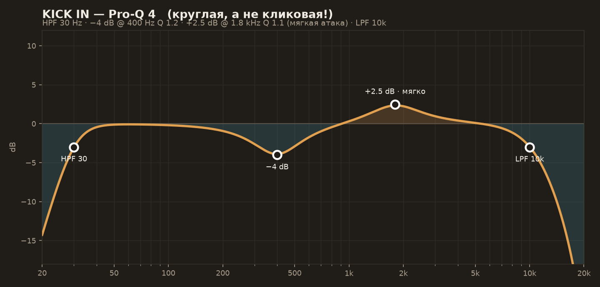
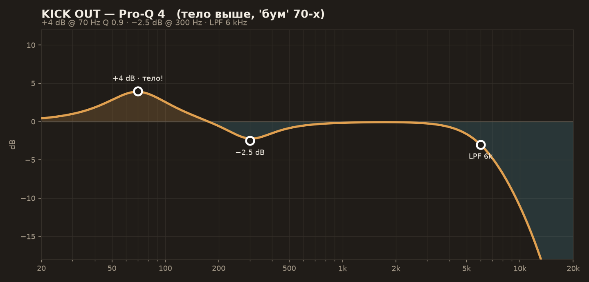
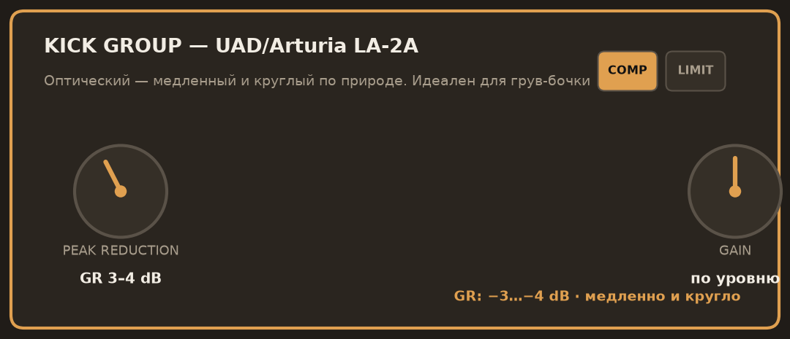

- [ ] `Kick beater`: EQ по кривой Kick In (круглая атака 1.8 кГц, не клик!)
- [ ] `Kick front`: EQ по кривой Kick Out (тело +4 дБ @ 70 Гц)
- [ ] Группа KICK: LA-2A GR 3–4 дБ → Decapitator T, Mix 30%

### Шаг 3. Рабочий (Snare top + bottom → группа SNARE)

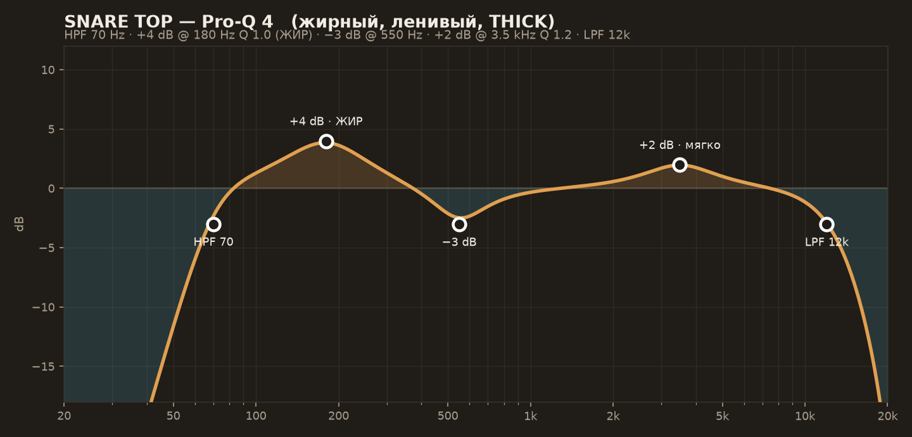
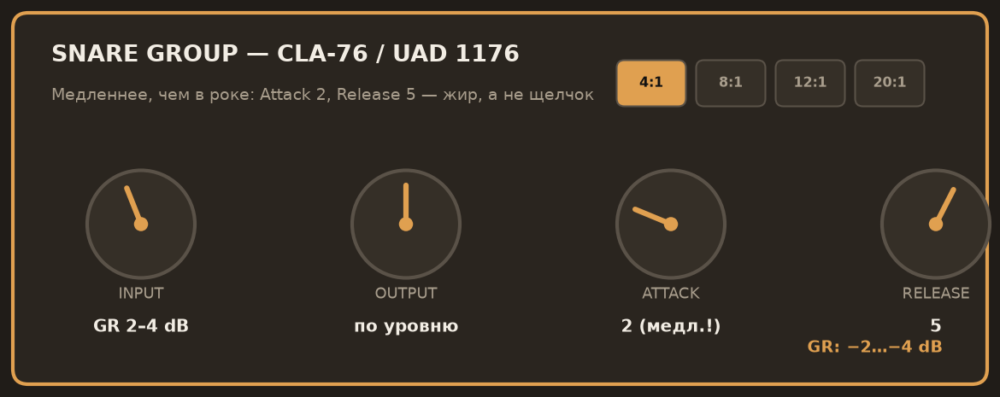

- [ ] `Snare top`: ЖИР +4 дБ @ 180 Гц, LPF 12k
- [ ] `Snare bottom`: ø! · HPF 400 · фейдер −10…−12 дБ ниже Top
- [ ] Группа: CLA-76 ленивый (Attack 2, Release 5, GR 2–4) — ghost-ноты дышат!

### Шаг 4. Томы и хэт

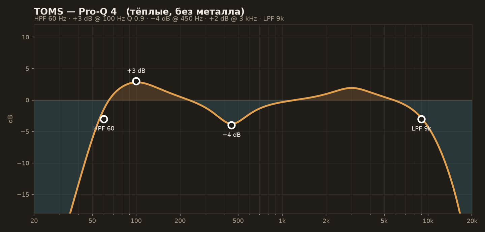

- [ ] `Tom 1/2/3`: EQ по кривой · гейт мягкий (Range −12) или без
- [ ] `HiHat extra dry` — основной: HPF 250 · для Morcheeba-вайба shelf −2 дБ @ 8k
- [ ] `HiHat`, `HH wet` — MUTE (wet можно вернуть −12 дБ как спецэффект)

### Шаг 5. Оверхеды и комната

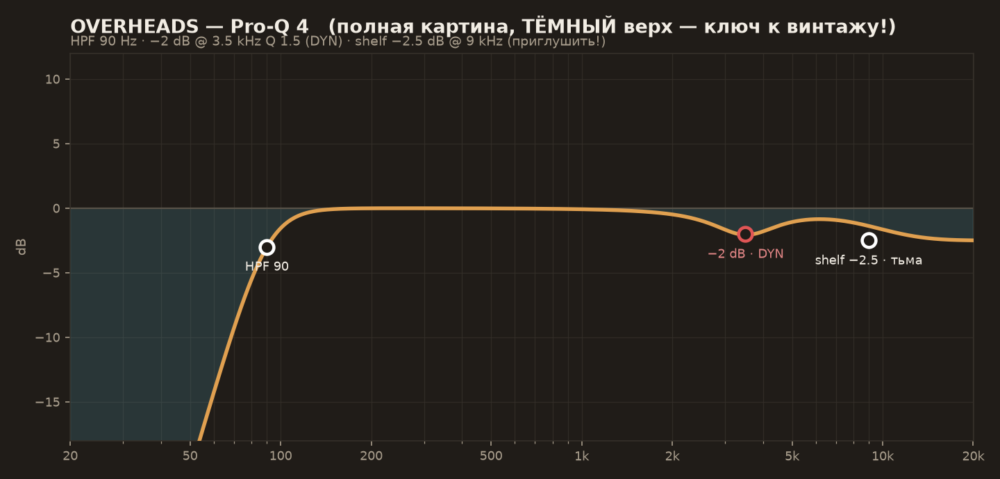
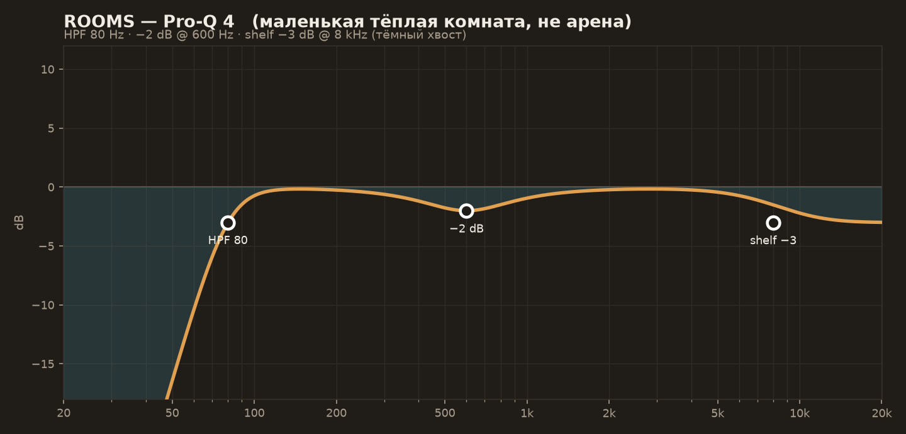
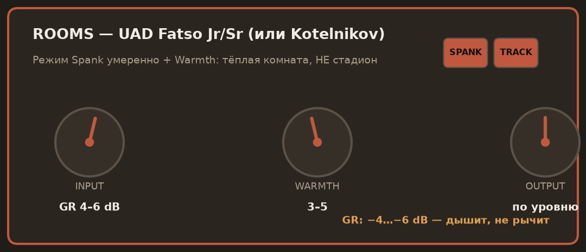

- [ ] `Overhead`: полная картина, HPF 90, ТЁМНЫЙ верх (shelf −2.5 @ 9k)
- [ ] `Overhead HH_Cow`: подмешать −6…−8 дБ к основному (фаза проверена на Шаге 1!)
- [ ] `Room` → группа ROOMS: EQ → Fatso/Kotelnikov GR 4–6 дБ

### Шаг 6. Ковбелл 🔔

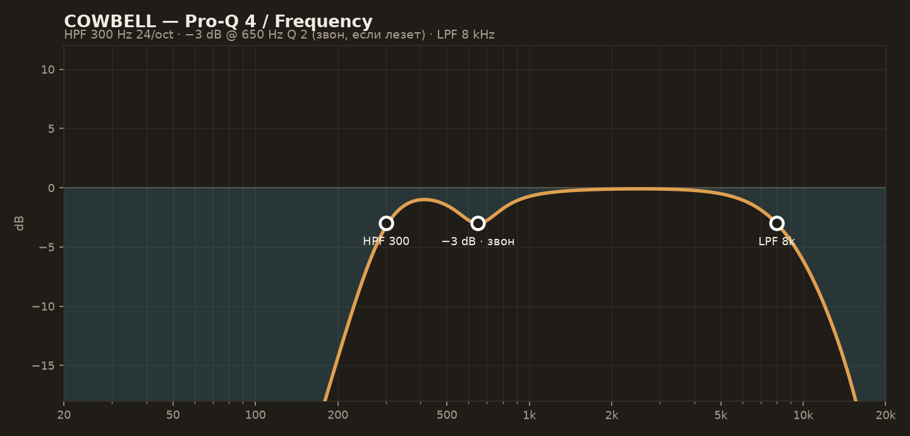

- [ ] HPF 300 · LPF 8k · узкий −3 дБ @ 650 Гц, если «звенит»
- [ ] Панорама — как слышно в Overhead HH_Cow (обычно чуть вправо/влево)
- [ ] Фейдер: −10…−14 дБ ПОД хэтом · чуть Decapitator N для винтажа

### Шаг 7. Гитары (Guit 1/2/3 → группа GTR)

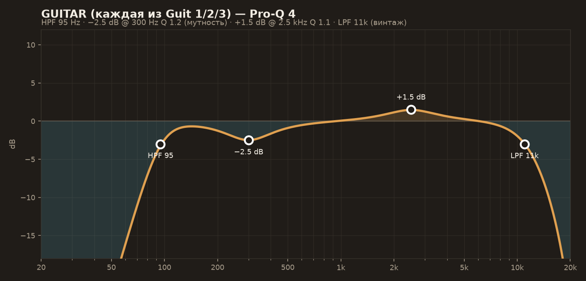
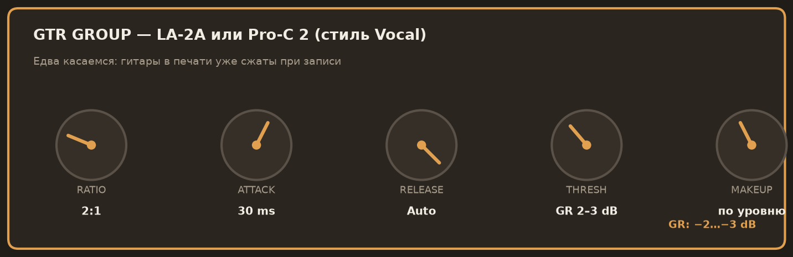

- [ ] На каждой: HPF 95 · −2.5 дБ @ 300 (мутность) · LPF 11k (винтаж!)
- [ ] Панорамы: Guit 2 ← L30–50 · Guit 3 → R30–50 · Guit — центр/чуть вбок
- [ ] Группа GTR: LA-2A или Pro-C 2 (2:1, GR 2–3 дБ) — едва-едва
- [ ] `* dry` версии — MUTE (запас под реамп)

### Шаг 8. Клавиши и синты (→ группа SYNTH)

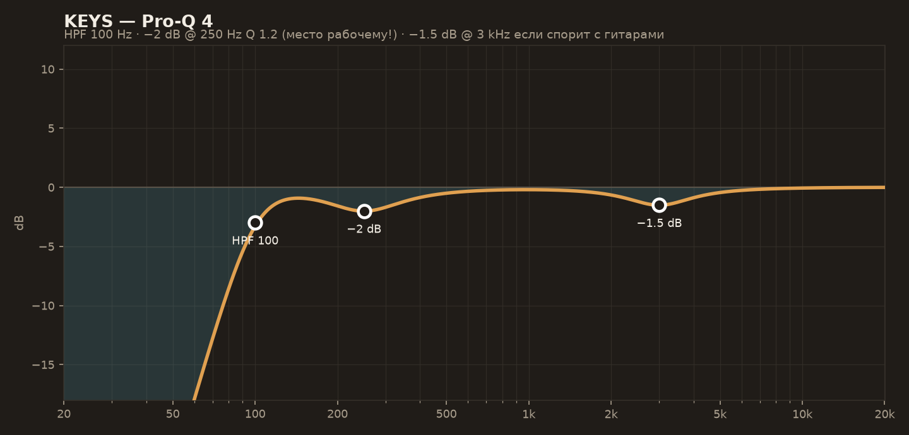
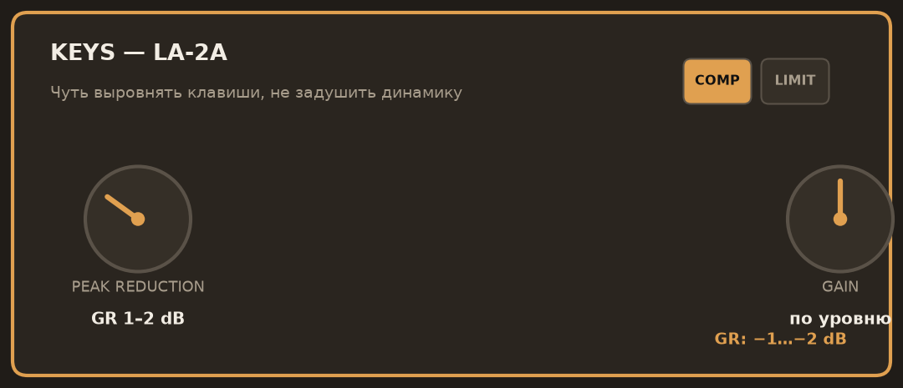
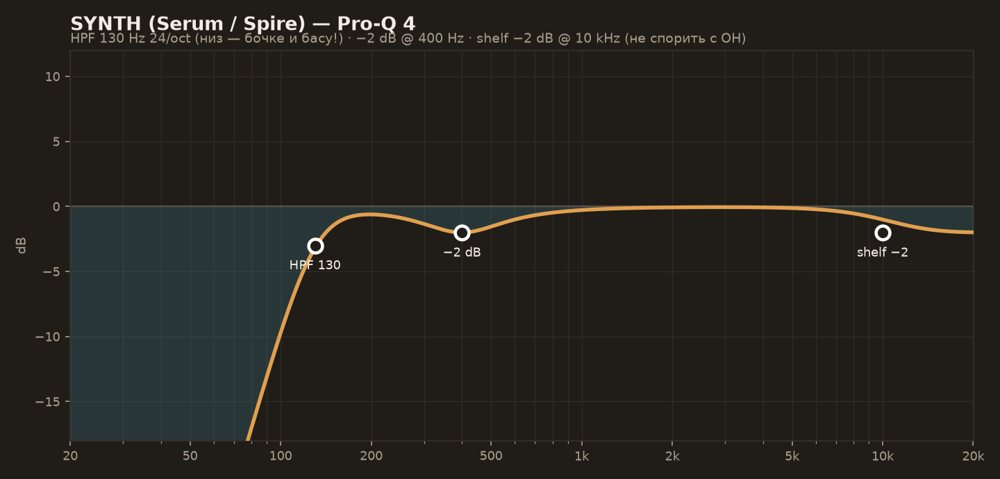
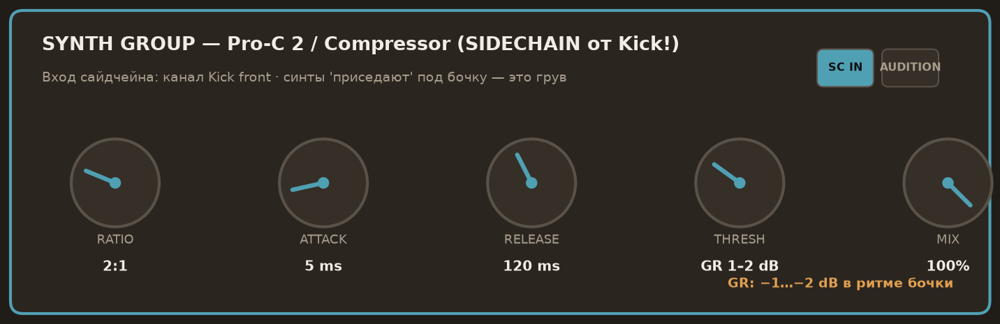

- [ ] `Keys`: HPF 100 · −2 дБ @ 250 (место рабочему) · LA-2A GR 1–2
- [ ] `Serum 2/3`, `Spire-1.5*`: слои прослушать ПО ОДНОМУ, лишние MUTE
- [ ] На каждом синте: HPF 130 (24 дБ/окт!) · shelf −2 @ 10k
- [ ] **Группа SYNTH: сайдчейн-комп от Kick front** — Ratio 2:1, Attack 5 ms, Release 120 ms, GR 1–2 дБ. Синты «приседают» под бочку — это и есть грув! (В Cubase: Pro-C 2/Compressor → активировать Side-Chain → в Sends канала Kick front послать на SC-вход)

### Шаг 9. Шины

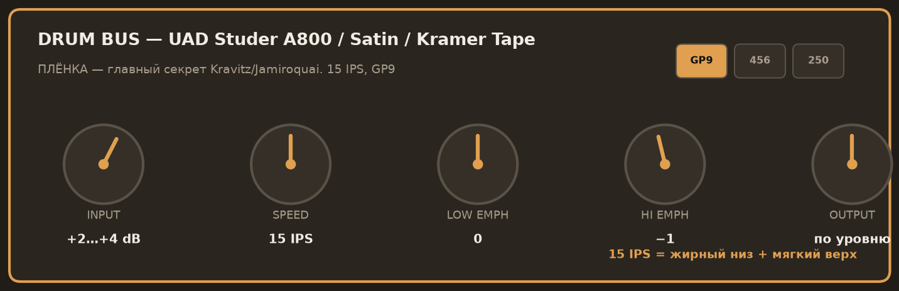
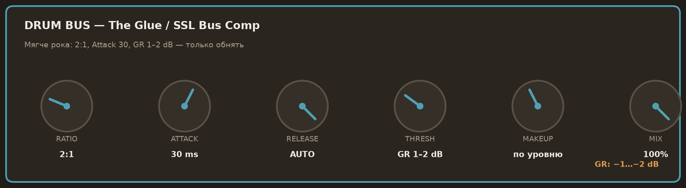
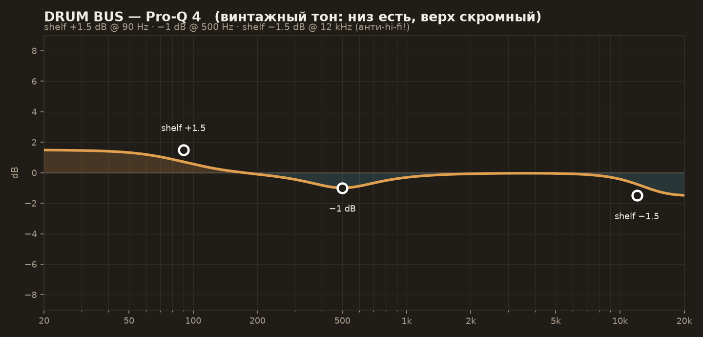

- [ ] DRUM BUS: плёнка 15 IPS (+2…+4) → Glue 2:1 GR 1–2 → EQ винтажный тон
- [ ] FX FAT и FX Verb — по groove-карточкам (LA-2A параллель, тёмная Room 0.9 с)

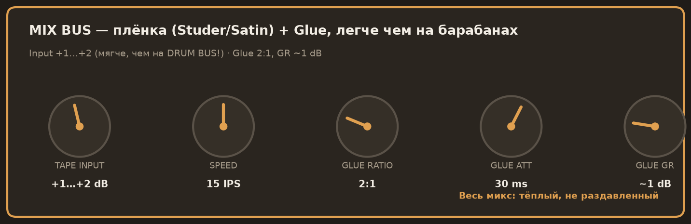
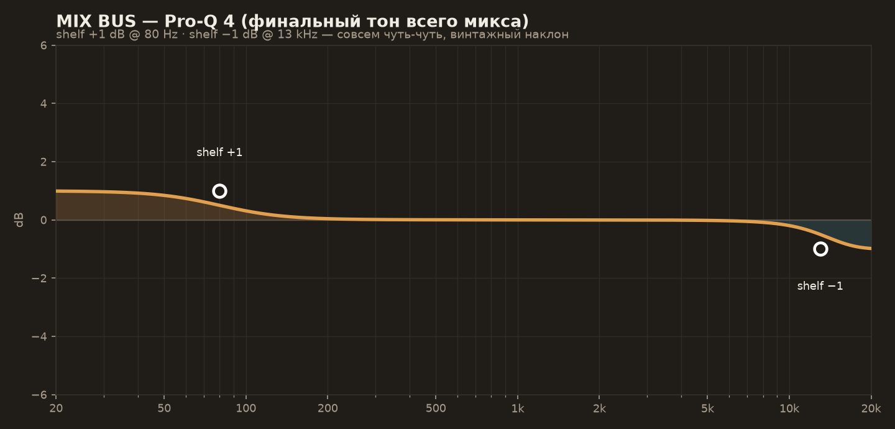

- [ ] MIX BUS: плёнка мягче (+1…+2) → Glue GR ~1 дБ → shelf +1 @ 80 / −1 @ 13k
- [ ] Лимитер здесь НЕ нужен (это сведение, не мастеринг) — только контроль пиков

### Шаг 10. Баланс и сверка

- [ ] Баланс жанра: **рабочий ≥ бочки** · хэт заметный · гитары вокруг барабанов · синты — подложка
- [ ] **A/B с Master.wav** на одинаковой громкости: где у автора жирнее/ярче/шире?
- [ ] Проверка в моно · проверка на маленьких колонках

---

## 4. Типичные грабли мультитрека

1. **Стемы не с 1-го такта** → всё разъехалось: проверяйте по клику/минусу
2. **Забытые mute** на Master/minus → «почему микс двоится?!» 😄
3. **Два хэта одновременно** (HiHat + extra dry) → фленджер-гребёнка. Только один!
4. Печёные FX поверх своих FX → каша. Сначала свои, потом решать
5. Синтовый суб + бочка без сайдчейна → гудящий низ
